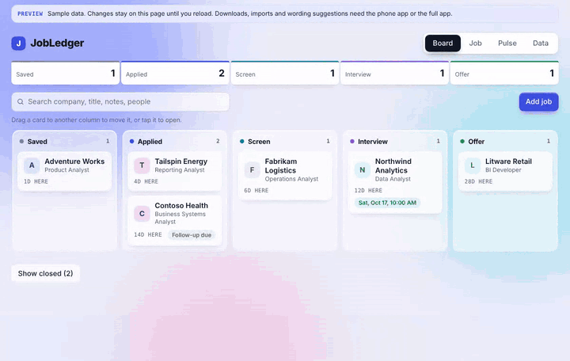
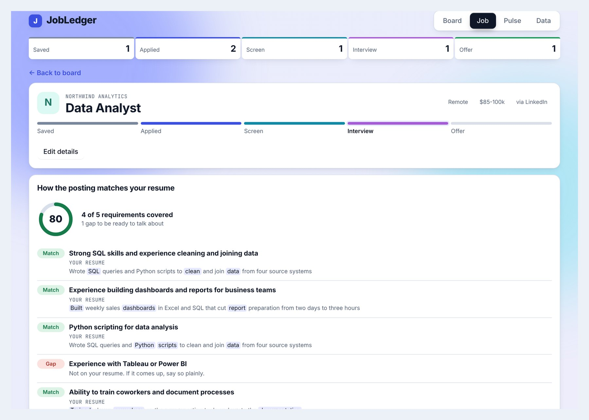
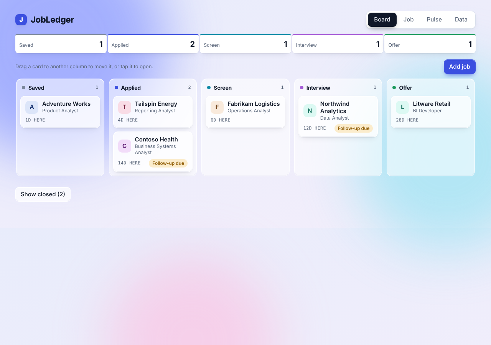
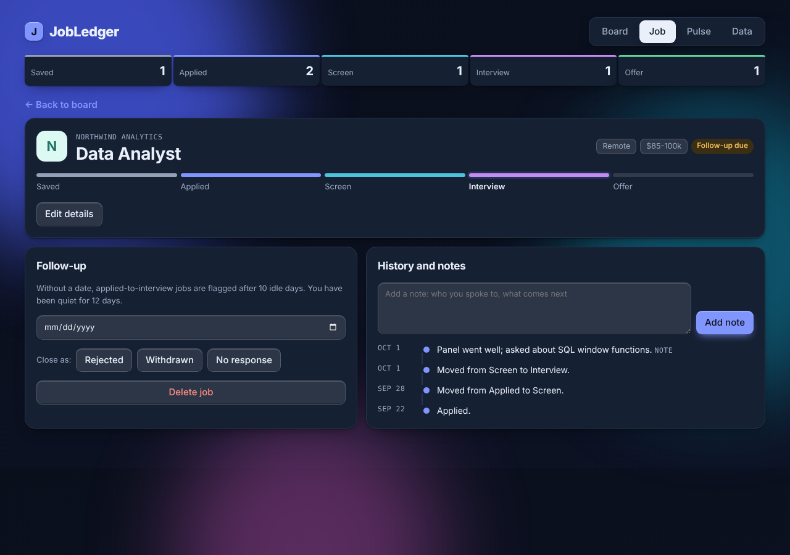
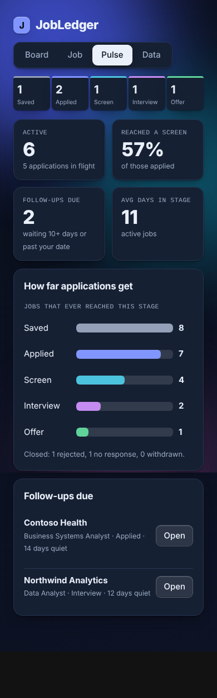

# JobLedger

A private job application tracker. It needs no account, costs nothing to run and sends nothing anywhere unless you ask. The same interface runs three ways:

| | Your data lives | You need | Fill from link |
|---|---|---|---|
| **[Phone app](https://jasonzawacki-arch.github.io/jobledger/)** | on your phone | Chrome on Android (or any browser) | only when connected to your server |
| **Server** | in a SQLite file on your computer or a cloud machine | Python 3.11+ and Node 18+ | yes |
| **[Demo](https://jasonzawacki-arch.github.io/jobledger/demo/)** | nowhere: sample data, reset on reload | a browser | no |

The phone app works on its own. It can also be pointed at your server (on your computer or in the cloud), and a backup file moves your data between them in either direction.



<details><summary>The resume-to-posting matcher</summary>



</details>



## What it does

- **Board** with five stages (Saved, Applied, Screen, Interview, Offer). Drag cards between columns or use the stage track on a job.
- **Closing a job** as rejected, withdrawn or no response keeps it in your history and funnel numbers but off the board. It can be reopened.
- **History timeline** for every job: stage moves, notes, follow-up dates and closures, each with a date.
- **Follow-up nudges.** A job is flagged when the date you set arrives. With no date, jobs at Applied, Screen or Interview are flagged after 10 idle days (any note or stage change resets the clock). Saved, Offer and closed jobs are never flagged.
- **Add a job from its link.** Paste the posting link and tap *Fill from link*: company, title, location, pay, posted date and the posting text are filled in from the job data most job sites publish (schema.org JobPosting), falling back to the page title. Anything you already typed is kept. The server fetches only the link you paste, refuses addresses on your own computer or local network (including after redirects), and caps the download. Some sites, LinkedIn especially, block automatic reading; for those, paste the text.
- **Where you found it.** Each job can record its source (LinkedIn, referral, recruiter, or anything you type).
- **Interviews.** Add interviews to a job with a date, time, length, what it is and where (address or video link). Each has an *Add to Google Calendar* button, and the calendar file on the Data tab includes upcoming interviews with an alert an hour before. While an interview is coming up, the job is not flagged for a follow-up, and its board card shows the next interview.
- **Pulse** dashboard: active jobs, how often applications hear back (reached a screen or later, or a rejection) and the median days until they do, applications per week for the last eight weeks, results by source, interviews coming up in the next two weeks, how far applications get (counted by the furthest stage each one ever reached, so a rejected interview still counts), and what needs a follow-up.
- **Your data stays yours:** CSV export, JSON backup and validated restore (all or nothing).
- **Resume matching.** Paste your resume once (Data tab) and a job's posting text (Edit details). The Job view lists each requirement as Match, Partial or Gap, with the resume line that supports it and the shared words highlighted. It works the same in the phone app and on the server, by comparing words, word forms (deliver, delivering, delivered) and common spellings (k8s/Kubernetes, Postgres/PostgreSQL), and counts a named tool as evidence of its general skill (SQLite shows databases; Salesforce shows CRM), but never the other way round. It runs locally and costs nothing.
- **People and prep.** Keep the recruiter or hiring manager on each job (with a one-tap "Contacted today") and an interview checklist, with an optional standard list.
- **Search** across company, title, location, pay, posting text, notes and contacts. Every word must match; closed jobs that match are shown too.
- **Reminders that reach you when the app is closed.** Each job with a follow-up (your date, or the day its idle nudge fires) has *Add to Google Calendar* and *Download .ics* buttons, and the Data tab downloads one calendar file for every open follow-up. Events are at 9:00 AM with an alert. Opening the Google link sends that event's text to Google; nothing else leaves your machine.
- **Follow-up email drafts.** A plain template filled in from the job and contact. Edit it, copy it, or open it in your email app. Nothing is sent from the app.
- **CSV import** from a simple spreadsheet (company and title columns, a few optional ones) or from your own export. All or nothing, with the row number in any error.
- **Optional wording suggestions** (off by default, bring your own Anthropic API key). See below.
- **Installable on Android** as a standalone phone app that works offline, or from your own server over HTTPS.
- Liquid-glass interface in light and dark, usable at phone width.

| Job, dark | Pulse, phone |
|---|---|
|  |  |

## 1. Phone app (no computer needed)

1. Open **https://jasonzawacki-arch.github.io/jobledger/** in Chrome on your Android phone.
2. Tap the menu (three dots) and **Install app**. JobLedger gets its own icon and works offline.

Everything is saved in the phone's browser storage. Download a backup from the Data tab now and then: it is your copy if the phone is lost or Chrome's data is cleared, and the server can restore it too. Fill from link needs the server, because a phone app is not allowed to read other websites; paste the posting text instead.

To use your server from the phone app, open **Data → Where your data is kept** and enter the server's https address. The server has to allow the app (see *Use the phone app with your server* below). You can switch back to the phone at any time; switching never copies or deletes jobs.

*Publishing it (once, for whoever owns the repository):* in the repository's **Settings → Pages**, set **Source** to **GitHub Actions**. The `phone app` workflow then builds and publishes the app and the demo on every push to `main`. Any static host works the same way: serve the contents of `dist/app` over https.

### Sync across devices (optional)

The phone app can keep the same jobs on a phone and a computer through your own Google Drive: **Data > Sync with Google Drive**. It is optional; the app and the demo never ask anyone to sign in.

- JobLedger keeps one file in the hidden app folder of your Drive (`jobledger-sync.json`); no JobLedger server is involved. Every job, event, contact, prep item and interview carries its last change time, and the newer change wins record by record. Deletes travel too.
- With sync on, new records get ids that cannot clash with another device's. The first sync on a device that already has jobs asks whether to combine both (records whose ids clash are renumbered, with their history), use the Drive copy, or replace it.
- Google access lasts about an hour without a server. While it lasts, changes sync on their own; after that a **Sync** button appears and one tap syncs again.

### Setting up Google sign-in (once, for the person who publishes the app)

Sync stays hidden until the app has a Google OAuth client ID. One ID works for both Daily and JobLedger, because both are published from the same address.

1. Open https://console.cloud.google.com, sign in, and create a project (for example "Daily and JobLedger").
2. **APIs & Services > Library**: find **Google Drive API** and click **Enable**.
3. **Google Auth Platform > Get started**: app name, support email, audience **External**, contact email, then **Create**.
4. **Data Access > Add or remove scopes**: add `https://www.googleapis.com/auth/drive.appdata`, then **Save**. Only this Drive scope is used; it reaches a hidden folder for this app and nothing else in the user's Drive.
5. **Audience > Test users**: add your own Google account. While the app is in testing, only test users can sign in. To let anyone sign in, click **Publish app**; drive.appdata is a non-sensitive scope, so Google asks only for basic app verification.
6. **Clients > Create client**: type **Web application**, and under **Authorized JavaScript origins** add `https://jasonzawacki-arch.github.io`. Click **Create** and copy the client ID (it ends in `.apps.googleusercontent.com`).
7. Put the ID in `GOOGLE_CLIENT_ID` in `src/engine/gsync-config.ts` here and in Daily (`src/gsync-config.ts`), then push. The client ID is not a secret: it names the app to Google.

## 2. Server (your computer or the cloud)

### Run it

```bash
pip install -r requirements.txt
npm install && npm run build      # builds all three versions into dist/ (needs Node 18+)
python -m jobledger --demo        # --demo loads made-up sample jobs into an empty database
```

Open http://127.0.0.1:8000. Settings come from environment variables:

| Variable | Default | Meaning |
|---|---|---|
| `JL_DB` | `jobledger.sqlite3` | database file |
| `JL_HOST` / `JL_PORT` | `127.0.0.1` / `8000` | where to listen |
| `JL_TOKEN` | unset | if set, every API call needs it (the UI asks once) |
| `JL_HOSTS` | unset | extra host names to answer on without a token, comma-separated (e.g. `laptop.local`) |
| `JL_TZ` | this computer's zone | time zone for follow-up dates, e.g. `America/New_York` |
| `JL_ORIGINS` | unset | phone-app addresses allowed to use this server, e.g. `https://you.github.io` (needs `JL_TOKEN`) |

### Open the server's own page on your phone

The simplest private way is [Tailscale](https://tailscale.com/download) (free for personal use):

1. Install Tailscale on the computer running JobLedger and on your phone, signed in to the same account. In the Tailscale admin console, make sure MagicDNS and HTTPS certificates are on (DNS page).
2. Start JobLedger with `python -m jobledger --tailscale`. It runs `tailscale serve` for you and prints an address like `https://laptop.tail1234.ts.net`.
3. Open that address in Chrome on your phone, then tap the menu and **Install app**.

On Windows, double-click `start-jobledger.cmd` instead of step 2 (it builds the app the first time). To start JobLedger when you sign in, press Win+R, type `shell:startup`, and put a shortcut to that file in the folder that opens.

Only devices signed in to your Tailscale account can open the address. JobLedger allows that name automatically and stops the HTTPS address when it exits. Setting `JL_TOKEN` as well is still a good idea. Any other HTTPS tunnel works too: list its host name in `JL_HOSTS`, or set `JL_TOKEN`.

### Use the phone app with your server

Start the server with a password and the phone app's address, over https (Tailscale or your cloud host provides it):

```bash
JL_TOKEN=pick-a-password JL_ORIGINS=https://jasonzawacki-arch.github.io python -m jobledger --tailscale
```

(On Windows, set both in `start-jobledger.cmd`.) Then in the phone app, open **Data → Where your data is kept**, enter the server's address and the password. The server refuses other sites even then, and every request still needs the password. Plain `http://` addresses are blocked by the browser, except `localhost`.

### Going live in the cloud

Not needed for the phone app, which works on its own. A cloud server is for having your data on a machine that is always on, with Fill from link available from anywhere. Any host that runs Python and gives you an https address works (a small virtual server, or a platform such as Fly.io or Render). What it needs:

- Build first: `npm install && npm run build`, then `pip install -r requirements.txt`.
- Run `python -m jobledger` with `JL_HOST=0.0.0.0`, the host's port in `JL_PORT`, and `JL_DB` pointing at a disk that survives restarts (the SQLite file is your data).
- Always set `JL_TOKEN`. Set `JL_ORIGINS` to the phone app's address if you will use the phone app with it.
- Keep backups: download one from the Data tab now and then, or copy the SQLite file.

This has not been tried on a specific provider yet, so expect a little setup on whichever you pick.

## 3. Demo

**https://jasonzawacki-arch.github.io/jobledger/demo/** is the phone app running on made-up sample data. Changes stay on the page until you reload, and nothing is saved, so it is the place to try the interface. Downloads, imports and wording suggestions are switched off there.

`npm run build && python preview/build_preview.py` builds it: `dist/app/demo/index.html` for the website and `dist/preview.html` as a single file for hosts that add their own page wrapper. The sample data comes from the server's `--demo` loader.

## Wording suggestions (optional, your own key)

Add an Anthropic API key on the Data tab and a "Suggest wording" button appears under each matched requirement. It sends that one resume line and that one requirement to Claude and shows the reply next to your original with every changed word highlighted.

- The line is always read from your stored resume, never from the request.
- The key stays in your browser's local storage. With the server, it travels only in a header on those requests and the server uses it once without storing or logging it. In the phone app, the phone sends the request straight to Anthropic.
- Each suggestion is a short request on your own account (the default model is `claude-haiku-5-5`, change it with `JL_MODEL`). Without a key, nothing is ever sent anywhere.
- A check rejects replies that add numbers, names or tools that are not in the original line. This catches the obvious ways to invent things. It is not a proof, so read each suggestion before you use it.

## How accurate is the matcher?

`python eval/run.py` scores it against 74 hand-labeled requirements in three sets. Two were used to tune it (30 of 33 and 14 of 16 agree). The third, 25 labels written before the latest changes and never used to adjust it, is the honest number: 80% agree (76% before those changes). It has never called a true gap a match in any set; its misses lean cautious (calling a match "partial"). These are small samples, so treat the percentages as a rough guide, not a guarantee. Tests fail if false matches appear or accuracy drops below a floor.

## Tests

```bash
python -m unittest discover -s tests -t .   # rules, API over real HTTP, matcher accuracy, and browser flows
npm run typecheck
```

Rule tests use an injected clock, so "10 days idle" is tested without waiting. Browser tests (Playwright) cover add, drag, notes, close, delete confirmation, backup and restore, escaping of hostile text, phone width, themes and the token prompt. Phone-app tests serve `dist/app` as plain files and check that data survives a reload, that it works offline, that backups move between phone and server both ways, CSV and calendar files, wording suggestions against a fake Anthropic, connecting to a server and back, and that the app never calls a JobLedger server on its own. A parity test runs every labeled matcher case through both the Python and the TypeScript matcher and requires identical results (needs Node). Browser tests skip themselves if Playwright or the built files are missing; the real Anthropic API is never called.

## Design notes

- `jobledger/service.py` holds every rule and knows nothing about HTTP. `api.py` is a thin JSON layer.
- Schema is versioned with `PRAGMA user_version`; the app refuses to open a database from a newer version.
- CSV cells that start with `=`, `+`, `-` or `@` are prefixed with `'` so spreadsheets do not run them as formulas.
- The UI escapes all text before rendering and only links http(s) addresses.
- The UI is TypeScript compiled by a small dependency-free `build.mjs` into one HTML file, three times: for the server (`dist/index.html`), the phone app (`dist/app/`) and the demo (`dist/demo/`).
- The phone app and the demo use the phone engine (`src/engine/`), a TypeScript twin of the server's rules that answers the same `/api` requests inside the page, so the interface code is identical in all three. Its data is kept in backup format in the browser's IndexedDB. The matcher exists in both languages and a test keeps them identical; when you change a rule, change `service.py` and `src/engine/local.ts` together.
- Other websites open in your browser cannot use the API. Writes from another origin are refused, request bodies must be `application/json` (which a plain form cannot send), and without a token the server only answers to `localhost`, `127.0.0.1` or names in `JL_HOSTS`, which blocks DNS rebinding.
- The token is accepted only in the `Authorization` header, never in the URL, so it does not end up in logs or history.
- The database is closed cleanly when the server stops.

## Honest limits

- **Phone app data lives in the browser.** Clearing Chrome's site data or uninstalling the app deletes it, and the phone app does not sync between devices by itself. Keep backups, or connect it to your server.
- **The server's own page on a phone needs HTTPS** and the computer must be on. `--tailscale` handles the HTTPS part; see above.
- **Calendar events are copies.** If you change a follow-up date, add it to your calendar again. Re-importing the .ics updates events in calendars that honor event IDs; the Google link always adds a new event.
- **Single user.** One token at most, no accounts. If you expose it beyond your own machine, put it behind HTTPS and set `JL_TOKEN` (without one, it refuses any host name other than localhost and `JL_HOSTS`). The token is sent as a bearer header and stored in the browser's local storage.
- **Time zone.** Follow-up dates follow the server computer's time zone (or `JL_TZ`). Calendar links and files use the time zone of the phone or browser you tap them on, so a 9:00 AM reminder lands at 9:00 AM where you are, whatever zone your Google account is set to. The CSV export's `created_utc` column stays in UTC.
- **No automatic updates from email or job sites.** You enter and move jobs yourself. *Fill from link* reads a posting once, when you ask.
- **Response numbers come from your history.** "Heard back" and "days to a reply" use the dates you moved jobs, so moving a card a week late makes the reply look a week slower.
- **Matching is word-based, not understanding.** It can miss a requirement your resume covers in different words, and a "Match" only means shared wording. It never rewrites your resume or adds claims: evidence is always a line copied from it. Suggested rewording, if added later, would be optional and use your own Claude API key.
- Backups include your resume and restore everything at once; there is no merge.
